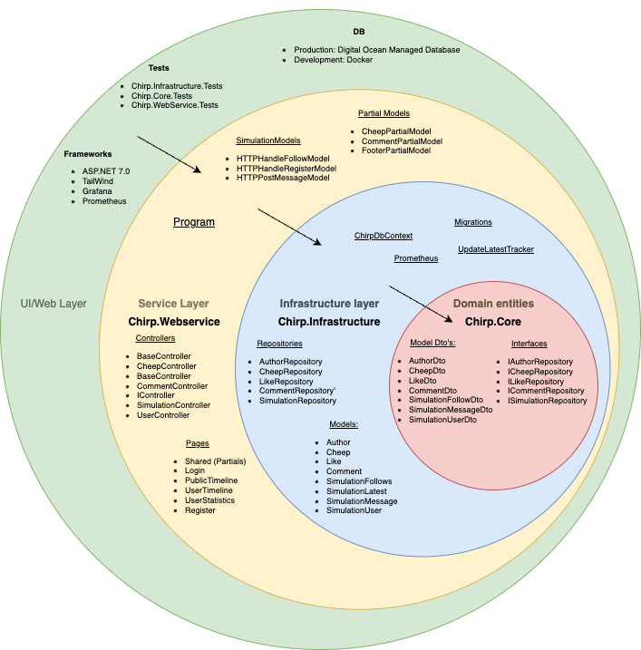
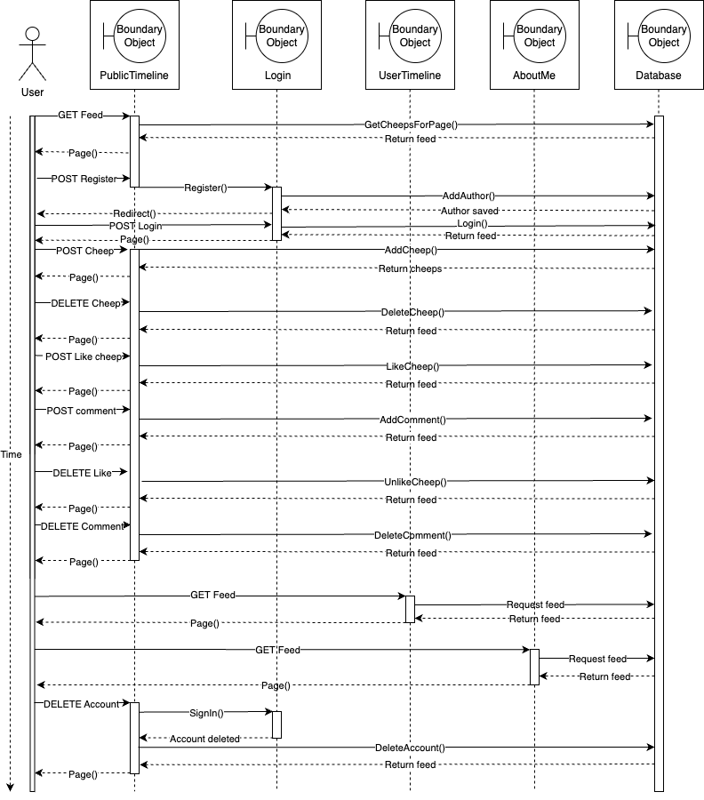
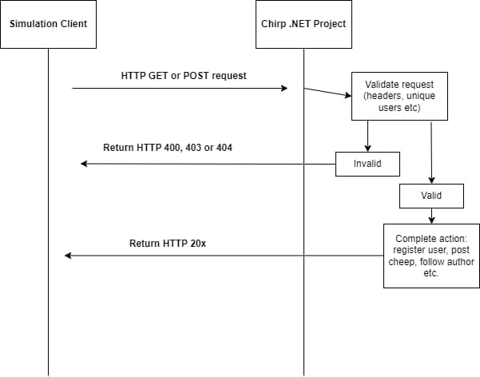
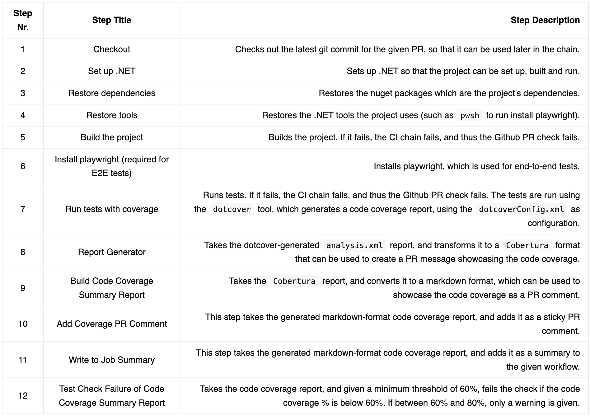
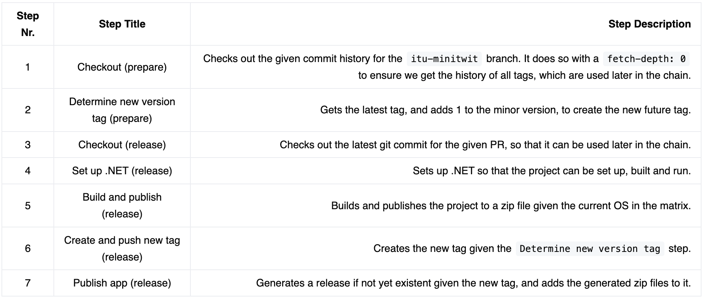
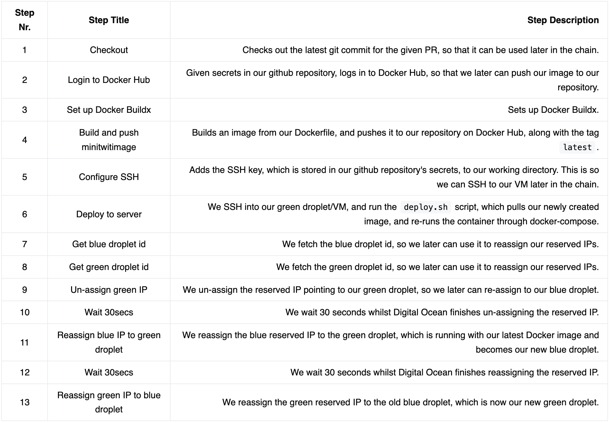
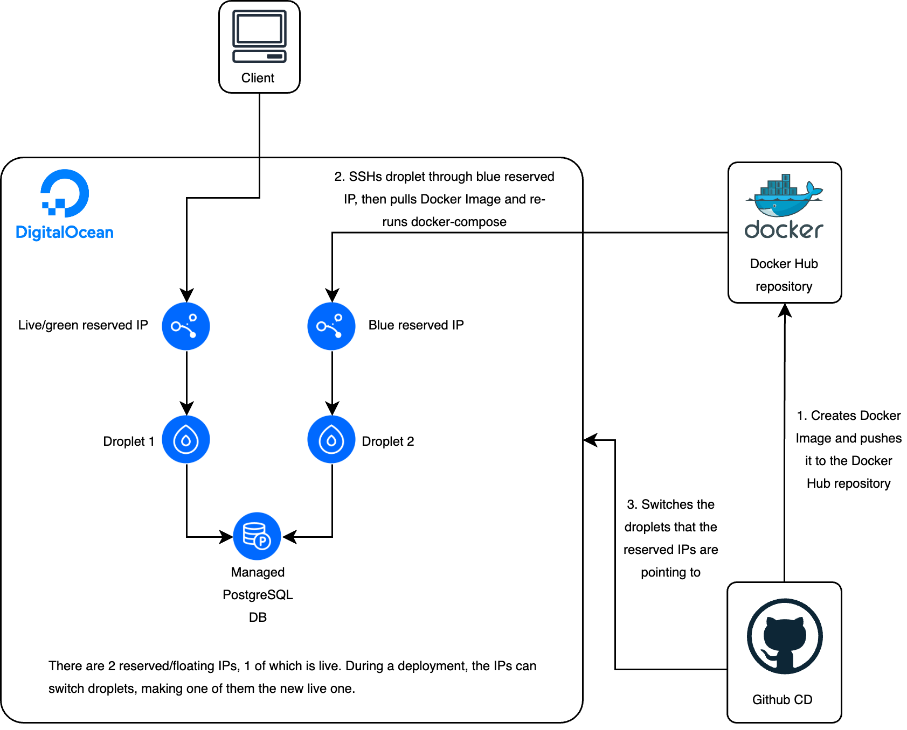

## System's Perspective
### The onion architecture

We chose to work with the onion architecture. The architecture provides loose coupling with the dependencies only
flowing inwards. The interactions between the layers are facilitated through interfaces and abstractions,
hence promoting loose coupling.
### The layers
- The Domain/Core layer
  - `DTOs` (Data Transfer Objects) to transfer data between layers in the system
  - `Interfaces` of the `repositories` to promote loose coupling
- The Infrastructure Layer
  - `Repositories` for data access with the Entity Framework in the `DbContext`
  - `Models`as the entities used in the `DbContext` on the same layer 
  - Additional services such as `Prometheus` and `UpdateLatestTracker` for monitoring the system
- The Webservice/Presentation layer
  - `Controllers` to handle HTTP request and responses with access to the `repositories`
  - `Pages` that contains UI components to render the data to the user. In our project they're referred to as Partials
- Web layer
  - The web layer is outside of the main project and represents external dependencies such as `Frameworks`, `Tests` and the `Database`
### Dependencies
We have utilized a range of tools. For coding and development, we have used: C# .NET and PostgreSQL for base functionality. We have used Tailwind CSS for UX/UI improvements. To ensure test-driven-development we have used Playwright and Moq in our test-suite. 

For version control we have used GitHub.

We have hosted our service at Digital Ocean, and done CI/CD through GitHub actions.

In addition, we also have the following dependencies:
- Docker
- DockerHub
- Vagrant
- Serilog
- Grafana
- Prometheus
- Loki
- AspNetCoreAnalyzers
- CSharpier
- EF Core
- OpenTelemetry

### Interactions of subsystems

### State of systems
The overall state of our system is good. We have been using SonarCloud to quantify the state of our system, and here we pass the quality gate. Although this comes with a caveat. Estimations from SonarCloud is that we have an estimated technical debt of 1 day and 3 hours. We have 95 issues spanning the following qualities:
- Security (11 issues)
- Reliability (18 issues)
- Maintainability (88 issues)

Therefore, if this project was to continue it would be preferable to address some of these, which could prevent vulnerabilities and increase the overall quality of the system.

## Process' perspective
### CI/CD Chain
#### CI Chain
Our CI Chain can be split into the following 3 workflows, where the latter 2 can be considered our main CI chains:
- Dependabot
- Sonarcloud
- Code coverage Chain

##### Dependabot
Dependabot is used to, on a weekly basis, make us aware of dependencies which have new versions, such that we stay up-to-date with our dependency ecosystem.
It creates a PR for each out-of-date dependency, which we can then choose to accept or decline.
This is a built-in bot provided by Github.

##### Sonarcloud
SonarCloud is a tool which enables us to get an analysis of our project.
When a PR is created, an analysis is added as a sticky comment, which showcases potential issues with the implemented code, along with new potential security flaws.
It is also run on our default branch, which gives us an general analysis of the project.

##### Code coverage CI Chain
The code coverage CI chain attempts to build the project, then runs the tests whilst creating a test coverage report.
It is run on every created pull request to our `itu-minitwit` branch.

It has the following steps:

This chain ensures that we can build the project, our tests pass, and that enough of the code is tested at all times.
Furthermore, it is also used as a reminder for the developers to write tests to their newly implemented features.

##### CI Chain reflections
Looking back at it now, we should have been better at utilising and respecting our CI chains.
This is mainly due to use prioritising other tasks, which ended up taking most of the time we allocated to the project.

Although setting up Dependabot, we weren't good at continuously updating the recommended dependencies, which we should have done as a weekly ritual.

Furthermore, early on in the project, we had commented out our 2 primary CI chains during a major refactoring of the project, and had forgotten to un-comment it.
Looking back at it, we should have never uncommented them, but rather just adjusted to them, as it could have led to some serious consequences.

#### CD Chain
Our CD Chain can be split into the following 2 workflows:
- Publish App Chain
- Continuous Deployment Chain

##### Publish App CD Chain
Our publish app CD chain is run on a schedule, which is every Thursday. It is responsible for creating a minor release once a week.

It can be split into the `prepare release` and `release app` jobs, where the latter job runs as a matrix for the OS' `linux-x64`, `win-x64` and `osx-x64`.
It has the following steps:

This ensures that we continuously deliver releases.

[//]: # (TODO: Something about why we need to continuously deliver releases?)

##### Continuous Deployment CD Chain
In Digital Ocean, we have already provisioned 2 VMs, along with 2 reserved IPs pointing to them, following the green-blue deployment model.
Our CD chain is responsible for updating our VMs in Digital Ocean, and switch the reserved IPs in order to minimise downtime during deployments.
This CD chain is run on every push to the `itu-minitwit` branch, and can be triggered manually.

It has the following steps:

In short, when we start a deployment, we:
- Build and upload the new docker image to Docker Hub
- SSH into our green droplet
- Update the Docker image and restart using docker-compose
- Switch reserved IPs

This ensures that we continuously deliver the latest version of our application, whilst minimising our downtime during deployment thanks to our green-blue deployment model.
In this scenario, we decided to use Digital Ocean's API to make the switch between green and blue droplets, and have used the reserved IPs as our router.
Furthermore, with this CD pipeline, we can also easily can go back to the "non-live" droplet by switching the reserved IPs, in case the live droplet is somehow erroneous.

The main potential weakness we see with this CD chain, is in case 2 deployments are started in quick succession.
In that case, we don't know how the deployments will interact.

For a more robust CD chain, we should probably ensure that only one deployment can run at once.
However, due to time constraints, we weren't able to implement this.

### Monitoring
#### How do we monitor
We do pull-based monitoring, utilizing Prometheus and Grafana. Grafana pulls from Prometheus, which again pulls from our application.

#### What do we monitor
Our monitoring is passive blackbox. We monitor the following in our application.
- The duration of HTTP requests
- Average duration of HTTP requests
- What endpoints are being hit
- What HTTP response is returned

### Logging
#### How do we log
We use the .NET log framework Serilog to collect custom as well as system logs from our program.
Serilog is a simple way to send logs to a specified output.
In our case the collected logs are outputted to Loki, which is running as a container.
Loki acts as a log aggregator, which efficiently indexes the logs only based on its metadata,
instead of the whole log text, which makes logs available milliseconds after they are received by Loki.
We then use Grafana to visualize the collected logs from Loki.
#### What do we log
Per default we log everything from 'log level' information. This is to ensure, that in case something goes wrong while live, we can get access to all necessary information as normally displayed in the terminal. Furthermore, we have also implemented some custom log prints, which prints whenever a controller is called, to help us trace user behavior.
### Security
From the security assessment we realized that our ports on different containers were public. This is a theoretical security issue, both since software such as Grafana is authenticated with a user-login, we felt this was not a major risk. 

Another reflection was on using SSH keys. This enabled us to not send password through network traffic, thereby reducing risk of interception. Our project was also layered with SSL while hosted on Digital Ocean. 

In general, our simulation endpoints were 'protected' with an auth-header and sensitive information such as configuration secrets were ensured to not be committed to VCS. User passwords stored in database were encrypted with SHA256. 

### Strategy for scaling and upgrades
#### Scaling strategy
When it comes to scaling, we didn't have enough time to implement a solution.
However, we did still make some considerations regarding it.

The first thing we would have done would be to implement some kind of horizontal scaling strategy. 
We wanted to do this with Docker Swarm, where on our droplet, we could orchestrate container replication, along with utilising load balancing.

This would have improved the availability of our application.
However, it might have also caused some problems, as we would've started building a distributed system.
This would have likely led us to have issues with having had to synchronise our logging and monitoring tools across our container replicas and our load balancer.

#### Upgrades
Regarding which upgrades we made to our project, one notable one was the implementation of the green-blue deployment model.
The diagram below shows our setup in Digital Ocean, along with how our toolchain interacts.

The way we implemented green-blue, was by having 2 droplets at all times, with 2 reserved/floating IPs pointing to them.
One of those IPs is pointing to our live droplet (green), whilst the other one is pointing to a non-live one (blue).
Furthermore, the droplets also share the same Managed PostgreSQL DB.

Our CD chain ensures that the deployment is applied to the droplet to which our non-live reserved IP is pointing to.
Thereafter, the CD chain switches the reserved IPs, such that the live reserved IP now pointing to our previously non-live droplet, and the non-live reserved IP is now pointing to our previously live droplet.
This repeats on every deployment.

The objective with this setup is to ensure very low, to no downtime during deployments.
Furthermore, this also allows us, in case we find out our live droplet is erroneous, to switch back to a our previously live droplet.

### Reflection on AI assistance
During the project we've used ChatGPT to search for information and code snippets for guidance.
It is a mutual opinion in the group that copy-pasting our code to any chat bot or other AI tools should be avoided
as we're unaware of where the data is stored and exactly who has access. Therefor we view AI tools such as ChatGPT 
as an addition to Google where we can search for information and get answers to our questions.
Additionally, manual development has the best learning outcome.

## Lessons Learned Perspective
Describe the biggest issues, how you solved them, and which are major lessons learned with regards to:

### Continuous refactoring
At the beginning of the simulation, we implemented functionality for receiving HTTP requests and storing data in separate tables unrelated to 'real' data. This data served the relevant HTTP simulation endpoints, but was purposely not visible on our applications feed. 
Later on we then had to display this simulation data, which initially prompted us to change how we processed incoming requests. However this would require a migration, which we feared could cause a wipe of our database. 
Therefore we had to figure out a way to transform incoming data into visible data, without changing data-models (and causing a migration). Ultimately we made it possible to transform this data in feed-viable data, without changing models. See commits `ec8c79d2` and `39a2df11`.

### Operation

### Maintenance
In the beginning we experienced short downtimes on our droplet when we deployed a new version of our system.
With the implementation of Green-Blue we've succeeded with deployment without downtime, which will enhance user
experience and monitoring is shown without misleading information. 

During the project we've had more focus on operations rather than development. 
Compared to previous projects, our primary focus was to establish foundations to make DevOps possible.
We've created a Blue-Green cloud solution to avoid downtime, monitoring and logging 
to keep track of the system after deployment, and CI/CD Chain to ensure quality and avoid
potential failures when implementing new features. 
